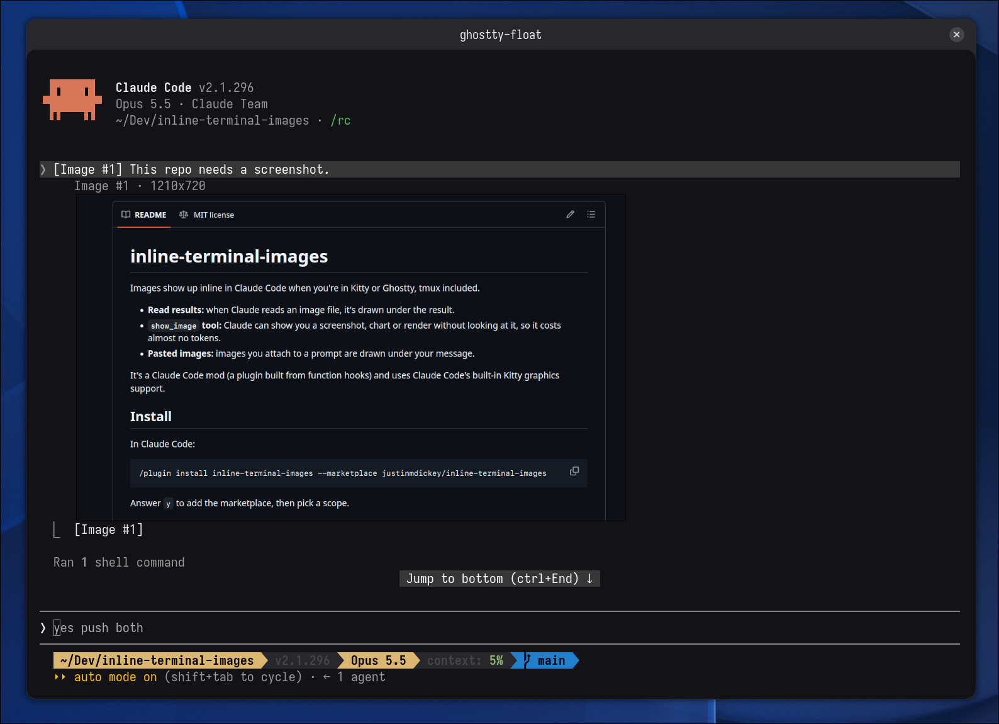

# inline-terminal-images



Images show up inline in Claude Code when you're in Kitty or Ghostty, tmux included.

- **Read results:** when Claude reads an image file, it's drawn under the result.
- **`show_image` tool:** Claude can show you a screenshot, chart or render without looking at it, so it costs almost no tokens.
- **Pasted images:** images you attach to a prompt are drawn under your message.

It's a Claude Code mod (a plugin built from function hooks) and uses Claude Code's built-in Kitty graphics support.

## Install

In Claude Code:

```
/plugin install inline-terminal-images --marketplace justinmdickey/inline-terminal-images
```

Answer `y` to add the marketplace, then pick a scope.

## Requirements

- Kitty or Ghostty
- Claude Code 2.1.296 or newer
- ImageMagick (`magick`) to convert JPEG, GIF, WebP and SVG and to snapshot `show_image` files
- python3 (cell size and tmux forwarding)

Only tested on Linux (Arch, Ghostty, tmux 3.8).

## tmux

Claude Code turns images off inside tmux, and when they're forced on it sends them in an escape that tmux drops. The mod works around both:

1. Allow passthrough in `~/.tmux.conf`:

   ```
   set -g allow-passthrough on
   ```

2. Force images on before starting Claude:

   ```fish
   set -gx CLAUDE_CODE_FORCE_TERMINAL_IMAGES 1   # fish
   ```

   ```sh
   export CLAUDE_CODE_FORCE_TERMINAL_IMAGES=1    # bash/zsh
   ```

Inside tmux each picture has a dim `#xxxxx` tag above it. That's how the mod tells pictures apart: after each draw, `bin/tmux-forward.py` reads the pane, pairs each image block with the tag above it, and sends the picture again through tmux passthrough. It skips anything it can't pair for sure.

tmux also reads every Kitty graphics command as a pane title, which would turn your window title into `Ga=T,U=1,...`. The mod sets a `pane-title-changed` hook on its own pane that puts the last real title back.

Optional: with `set -g default-terminal tmux-256color` and `set -as terminal-features ',xterm-ghostty:RGB'`, Claude Code uses 24-bit image ids, so ids get reused less.

## Limits

- A Read only draws its image when it gets its own row. Claude Code folds runs of reads into one "Read N files" line.
- The tmux workaround depends on how Claude Code draws image placeholders today, so an update could break it.
- Converted images are cached in `/tmp/claude-inline-images/`.

## Development

```
claude --plugin-dir .            # run Claude with the mod loaded from here
claude plugin validate .
claude plugin test .             # hook tests
python3 -I tests/forward_test.py # tmux forwarder tests
```

## License

MIT
